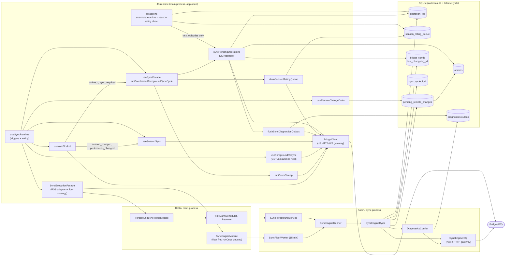
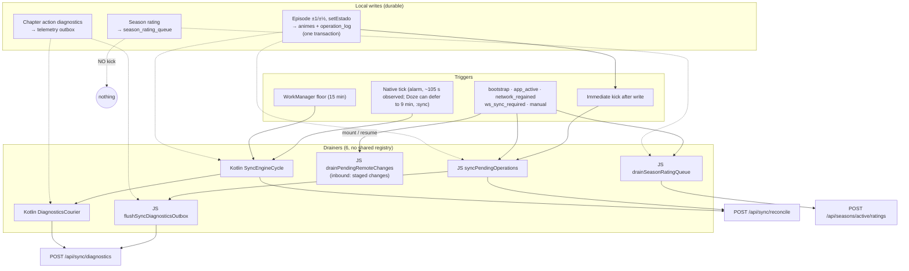
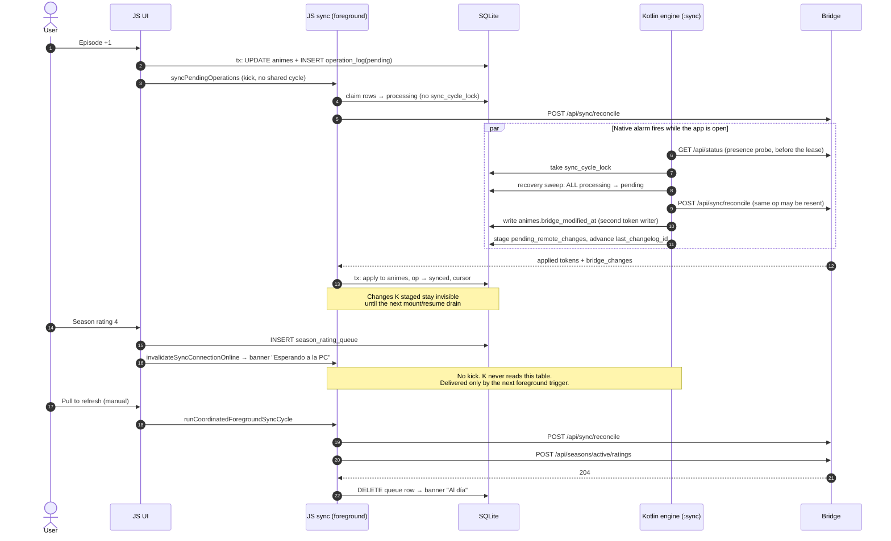

# Sync architecture audit (2026-10-16)

Input for [ADR 009](adr/009-convergent-sync.md), which decides the design. This is a read-only audit; no code was changed.

> **Corrected on 2026-10-16** after a dual review. I7 was withdrawn. The flow diagram now draws all six drainers. The sequence diagram now shows the presence probe before the lease, and the second writer of `bridge_modified_at` (Kotlin). The I6 citation was fixed. Section 5 is superseded by ADR 009.

**Method.** Two independent explorers mapped the sync system with CodeGraph from opposite ends:

- **A** went from the app outward: writes, triggers, and UI projections.
- **B** went from the bridge and storage inward: endpoints, tables, columns, Kotlin, and docs.

Their maps were reconciled. Every finding below either was reported by both explorers, or was reported by one and then checked against the code by the orchestrator. Items marked _(inferred)_ follow from reading the code, not from running it on a device.

**Context.** The user reports that sync works today in the foreground, in the background and with the tablet off. This audit is about **structure**: the missing shared pattern, dead code, legacy code, and latent risks. It does not claim functional regressions.

---

## 1. Component diagram

**There are two gateways and no shared dispatcher.** `BridgeClient` (JS) and `SyncEngineHttp` (Kotlin) each talk to the bridge directly. What leaves the device is decided in six separate places, listed in section 2.

---

## 2. Flow diagram: from local intent to the bridge

| Outbound kind | Immediate kick | Foreground cycle | Native tick/floor | Workflow |
|---|---|---|---|---|
| Anime mutations (`operation_log`) | yes, `anime-mutation.helpers.ts:290` | yes, `sync-facade.helpers.ts:124` | yes, `SyncEngineCycle.kt:210-245` | reference outbox |
| Season rating (`season_rating_queue`) | **no**, `use-season-rating-intent.ts:34` | yes, `sync-facade.helpers.ts:125` | **no**, no "season" in Kotlin | own queue, own drainer |
| Diagnostics (telemetry outbox) | piggybacks on reconcile | piggybacks | yes, `SyncEngineCycle.kt:205` | own DB, two drainers |

Inbound changes come in through three doors:

1. **JS reconcile.** It applies changes directly to `animes` (`reconcile.helpers.ts:198-212`).
2. **Native reconcile.** It stages changes in `pending_remote_changes` and advances the cursor (`SyncEngineResponseApplier.kt:35-98`). JS applies the staged rows only on mount or resume (`use-remote-change-drain.ts:39-57`).
3. **Snapshot heal.** `GET /api/animes` runs on mount and resume (`full-resync.helpers.ts:46`).

The WebSocket only acts as a trigger for anime changes. `season_changed` and `preferences_changed` are WS-only events: they get no reconcile and no native path (`use-sync-runtime.ts:176-190`).

---

## 3. Sequence diagram: an episode tap, a season rating, and a native tick with the app open

---

## 4. Findings

### 4.1 Inconsistent (an event kind does not follow its siblings)

| # | Finding | Evidence |
|---|---|---|
| I1 | A season rating is enqueued with no kick. The native engine never drains it, so delivery waits for a foreground trigger. **Confirmed on device 2026-10-16** (POST only after pull-to-refresh) | `season-rating-queue.helpers.ts:46-57`, `sync-facade.helpers.ts:125` |
| I2 | The episode kick skips the coordinated cycle. It never drains ratings, never reaches `online` (only `idle`), and records no started/succeeded status | `anime-mutation.helpers.ts:287-296` vs `sync-facade.helpers.ts:115-157` |
| I3 | Season 401 rows are documented as "needs explicit repair", but the drain re-posts them on every cycle | `sync-facade.helpers.ts:190-192`, `season-rating-queue.helpers.ts:192` |
| I4 | A rating delivery failure fails the whole foreground cycle, even when the reconcile succeeded | `sync-facade.helpers.ts:127-129` |
| I5 | Native conflict handling resets the op to pending with no attempt cap. JS caps attempts and re-bases | `SyncEngineResponseApplier.kt:70-88` vs `reconcile-conflict.helpers.ts:69-108` |
| I6 | The season refresh after a delivered rating updates the store but not `active_season_cache` | `sync-facade.helpers.ts:132` vs `use-season-sync.ts:81` |
| ~~I7~~ | **Withdrawn: not a defect.** Kotlin persists `foreground_service`, a member of the JS union, to `last_trigger_source`. `native_fgs_tick` is written only to the journal | `SyncEngineRuntimeStatus.kt:14-28` |
| I8 | WS `season_changed` and `preferences_changed` act on their own instead of triggering the shared cycle | `use-sync-runtime.ts:176-190` |

### 4.2 Latent risks (no reported symptom; worth a decision in the ADR)

| # | Risk | Evidence |
|---|---|---|
| R1 | **JS and Kotlin can claim the same `operation_log` rows.** JS never takes `sync_cycle_lock`. While Kotlin holds it, its recovery sweep returns every `processing` row to `pending`, including rows JS claimed and is sending. Native ticks are not gated on app state. Outcome: duplicate sends (masked if the bridge is idempotent per operation id) _(inferred)_. This contradicts ADR 008 decision 3, "single owner per store, with lease and fencing" | `SyncEngineRecovery.kt:8-10`, `SyncEngineDatabases.kt:67-68`, `reconcile.helpers.ts:331-338` |
| R2 | Changes a native tick pulls while the app is open advance the cursor but stay in staging until the next mount or resume _(inferred)_ | `SyncEngineResponseApplier.kt:90-98`, `use-remote-change-drain.ts:39-57` |
| R3 | Unpairing deletes only `bridge_config`. `operation_log`, `season_rating_queue` and `pending_remote_changes` survive into the next pairing | `client.helpers.ts:404-407` |
| R4 | Tearing down the ticker module calls `stopTicking()`, which persists `isTicking=false` and cancels the alarm _(inferred)_ | `ForegroundSyncTickerModule.kt:240-242`, `TickAlarmScheduler.kt:223-227` |

### 4.3 Dead (no production caller)

| Item | Evidence |
|---|---|
| `useReconcile` | `use-reconcile.ts:6` |
| `useIncrementalSyncHandler` | referenced by tests only |
| `initialSync`, `persistInitialSyncSnapshot` | `use-initial-sync.ts:9`, `initial-sync.helpers.ts:42`; pairing uses `fetchInitialSyncSnapshot` + `persistPairedBridgeConfiguration` |
| JS `pruneOperationLog` (prune is Kotlin-only) | `operation-log-retention.helpers.ts:195` |
| `recordBacklogReadCount`, `recordCycleActive`, `readOperationLogConvergence`, `countPendingOperationLog` | `sync-runtime-status.helpers.ts:382,393`, `operation-log-convergence.helpers.ts:31` |
| `registerPreferredStrategy` | `sync-execution-facade.helpers.ts:96` |
| `bridgeClient.getStatus` (JS), `ticker.isRunning` | `bridge-client.helpers.ts:247`, `native-foreground-sync-ticker.helpers.ts:58` |
| `SyncEngine.runOnce` AsyncFunction | `SyncEngineModule.kt:74` |
| The whole `SyncJournal` module (4 functions) | `SyncJournalModule.kt:188-219` |
| JS `applyMode: 'staged'` branch and `stagePendingRemoteChanges` from JS | `reconcile.helpers.ts:198-199, 449-452` |
| `sync_runtime_status` columns that nothing writes: `last_pruned_operations_count`, `last_*_count`, `last_oldest_pending_age_ms`, `foreground_service_callback_started_at`, `last_no_op_reason`, … | `client.constants.ts:37-46`; the only writer is the dead `recordBacklogReadCount` |

### 4.4 Dead-end (runs, but nothing consumes the result)

| Item | Evidence |
|---|---|
| `telemetryContext` / `checkpointRecorder`: no caller passes them, so `client_telemetry`, cycle envelopes and checkpoints are never built in JS | `reconcile.helpers.ts:69-78, 346-360`, `sync-diagnostics-flush.helpers.ts:315` |
| In-memory diagnostic ring: written from 8 files, never read | `sync-diagnostic-store.helpers.ts:16,65` |
| About 18 `sync_runtime_status` telemetry columns, written by JS and Kotlin and read only through the dead telemetry path | `sync-runtime-status-patch.helpers.ts:39-171`, `SyncEngineRuntimeStatus.kt:154-175` |
| `isBatteryOptimizationExempt` in `SyncExecutionStatus`: merged, then dropped by the patch builder | `sync-execution-facade.helpers.ts:56` |
| Native diagnostics drain tally: computed, then discarded | `SyncEngineCycle.kt:200-208` |
| Recovery state `pruned`: the cycle never moves into it | `SyncEngineRecovery.kt:16` |
| `normalizeFetchedAnime`: identity function | `full-resync.helpers.ts:15-28` |
| `operation_log.conflict_attempt_count` read by Kotlin and never used | `SyncEngineCycle.kt:27,436`, `ReconcileRequestBody.kt:18` |

### 4.5 Legacy (superseded, or duplicated across JS and Kotlin)

| Item | Should become | Evidence |
|---|---|---|
| Reconcile implemented twice (JS + Kotlin; backlog, body, parse, confirmation, cursor, 4xx→dead_letter agree; conflict handling does not) | one owner of transport | `reconcile.helpers.ts` vs `SyncEngineCycle.kt` |
| Diagnostics drain implemented twice over one file | one owner | `sync-diagnostics-flush.helpers.ts` vs `SyncEngineDiagnosticsCourier.kt` |
| Notifee ForegroundService manifest patch (Notifee is only used to request permission) | remove from the plugin; the release guard checks it, so update the guard too | `plugins/withAndroidForegroundSync.js:24,136-156` |
| `EXPO_BACKGROUND_WORKER` cancel | remove once no installed build carries it | `SyncFloorScheduler.kt:36` |
| Ticker default interval 15 000 (always overridden by 60 000) | remove the default | `ForegroundSyncTickerModule.kt:87` |
| Comments and docs pointing at deleted JS (`headless-sync-cycle`, `attempt-policy`, `sync-cycle-lock` helpers, "until T8 retires the JS path", "Headless cycles toggle this") | rewrite | `SyncEngineCycle.kt:65`, `SyncEngineRunner.kt:70`, `SyncCycleLease.kt:39`, `SyncEngineDatabases.kt:12-15`, `sync-runtime-status.helpers.ts:380` |
| Docs that disagree with the code: "user-enabled ticker" and "no resident FGS by default" (it is registered automatically); `doWork` vs `doRemoteWork`; the ticker drawn inside `:sync`; the diagnostics flush listed as deferred (it runs); `README.md:92` "ratings queue and sync like any other mutation" | correct | `docs/mobile-sync-engine-workflow.md:32,56-60,197,213`, ADR 008 decision 2, `SyncEngineRunner.kt:104-108` |

### 4.6 Reconciliation notes

- Both explorers independently reported I1, R1, R2, the six drainers, the two gateways, and every item in 4.3.
- **Single-explorer items checked by the orchestrator:**
  - R1's sweep guard only checks that the engine owns the lease, not who claimed the row (`SyncEngineDatabases.kt:67-68`).
  - No app-state gate exists in the native modules.
- **Rejected as a hole:** `defer_outbox` skips a remote change while a local op is pending for the same record. That is deliberate (`merge/apply-remote-changes.helpers.ts:75`): the local op wins, and the next reconcile returns the merged state.

---

## 5. Inputs for the ADR

> **Superseded by [ADR 009](adr/009-convergent-sync.md).** Item 1 (one table with a `kind` column) and item 3 (one transport owner) were rejected. The decision keeps the three queues, and puts one registry and one exit in each runtime, guarded by compare-and-set and per-key claims.

1. **One outbox, typed messages.** `operation_log` and `season_rating_queue` become one transactional outbox whose rows carry a `kind`, plus a registry of per-kind senders. Telemetry stays separate on purpose: it lives in its own DB, is lossy and is capped.
2. **One entry point.** Every trigger calls one `requestFlush(reason)` with single-flight. No trigger knows which kinds exist, and an immediate kick after every write follows from that.
3. **One owner of transport per moment, fenced.** Decide between two options:
   - (a) JS takes `sync_cycle_lock` too;
   - (b) Kotlin owns every send, and JS only writes and wakes it, as ADR 008's direction suggests.

   This resolves R1 and the duplicated reconcile and diagnostics.
4. **One inbound applier.** Either always stage and drain on a signal, or have Kotlin notify JS after it stages. This resolves R2.
5. **WS stays notify-then-pull**, and every event type maps to a flush or a refresh reason.
6. **Clean-up before or alongside:** delete 4.3, delete or wire 4.4, fix the docs in 4.5.
